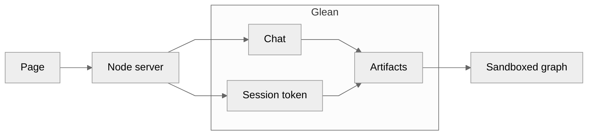

# example-html-artifact-render

One page asks Glean to generate an HTML artifact, waits for it, and renders the result. The server makes the Glean calls and logs each one.

**[View the rendered sample](https://alex-mahabir-glean.github.io/example-html-artifact-render/)** — a static snapshot of `sample_volume.html` (Alpha 8, Beta 5, Gamma 13). The sort buttons in the chart work in that page. It does not call Glean.

## Architecture

Chat and artifacts are separate Glean calls, and each has its own credential. Arrows run left to right.



Chat uses the user's client token and returns an HTML artifact id. The server mints a short-lived session for that same user, downloads the artifact, and the page draws `content.text` in an iframe with `sandbox="allow-scripts"`.

Each Glean call is logged with the posted JSON indented, then a short response summary. The log omits credentials and the HTML body. The same summary is returned on `POST /api/generate` and shown on the page.

## Run

```bash
npm start
```

Copy `.env.example` to `.env.local` and fill in the values. Open http://localhost:3000. The server prints each Glean request like this:

```text
glean POST /rest/api/v1/chat 200 80699ms
request
{
  "headers": { "Authorization": "Bearer [redacted]" },
  "body": { "messages": [] }
}
response
{
  "chatId": "...",
  "artifactId": "..."
}
```

## Postman

Import these two files:

- `postman/glean-html-artifact.postman_collection.json`
- `postman/glean-html-artifact.postman_environment.json`

Set `baseUrl`, `clientToken`, `authTokenApiKey`, and `actAsEmail`. Run **Create session token**, then **Chat**, then **Get artifact**. You do not type `artifactId`. The Chat test script reads `artifactInfo.id` from the message whose `messageType` is `ARTIFACT_HTML` and stores it in `{{artifactId}}`. The session request stores `{{sessionToken}}`. A full chat response is in [postman/sample-chat-response.md](postman/sample-chat-response.md); its id is `bbaae4347e5844059081b55c36202f2e`.

```bash
npm test
```

## Layout

- `server.mjs` serves the page and wraps the Glean calls
- `lib/glean.mjs` calls chat, mints the session, and downloads the artifact
- `lib/glean-log.mjs` writes the call log
- `postman/` is the Postman collection and environment
- `public/app.js` is the form, the call log, and the sandboxed frame
- `docs/` is the static snapshot published with GitHub Pages

## Calls

- `POST /rest/api/v1/chat` with `allowedArtifactTypes: ["HTML_CODE"]`
- `POST /rest/api/v1/createauthtoken` with `GLEAN_AUTH_TOKEN_API_KEY` and `X-Glean-ActAs`
- `GET /api/v1/artifacts/{artifactId}`

User client tokens are accepted on chat. They are not accepted on `/api/v1/artifacts`.
