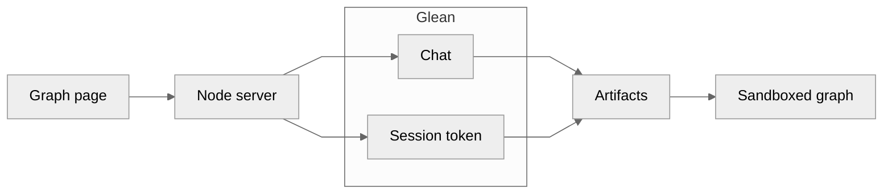

# example-html-artifact-render

A small page that asks Glean chat for an HTML graph, then downloads that artifact and renders it.

**[View the rendered sample](https://alex-mahabir-glean.github.io/example-html-artifact-render/)** — a static snapshot of `sample_volume.html` (Alpha 8, Beta 5, Gamma 13). The sort buttons in the chart work in that page. It does not call Glean.

## Architecture

The browser only talks to the Node server. Chat and artifacts are separate Glean calls, and each has its own credential. Arrows run left to right.



Chat uses the user's client token and returns an HTML artifact id. The server mints a short-lived session for that same user, downloads the artifact, and the page draws `content.text` in an iframe with `sandbox="allow-scripts"`.

## Run

```bash
npm start
```

Open http://localhost:8787. Copy `.env.example` to `.env.local` and fill in the values. Credentials stay on the server.

```bash
npm test
```

## Layout

- `server.mjs` routes the page and the `/api` proxy
- `lib/glean.mjs` calls chat and the artifact API
- `lib/artifact.mjs` reads the chat payload and artifact body
- `public/` is the page
- `docs/` is the static snapshot published with GitHub Pages

## Routes

- `POST /rest/api/v1/chat` with `allowedArtifactTypes: ["HTML_CODE"]`
- `POST /rest/api/v1/createauthtoken` with `GLEAN_AUTH_TOKEN_API_KEY` and `X-Glean-ActAs`
- `GET /api/v1/artifacts`
- `GET /api/v1/artifacts/{artifactId}`
- `GET /api/v1/artifacts/{artifactId}/versions`
- `GET /api/v1/artifacts/{artifactId}/versions/{version}`
- `PUT /api/v1/artifacts/{artifactId}/versions/{version}`
- `DELETE /api/v1/artifacts/{artifactId}`

User client tokens are accepted on chat. They are not accepted on `/api/v1/artifacts`.
